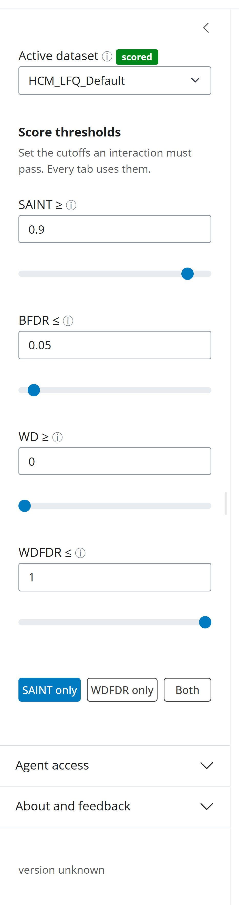
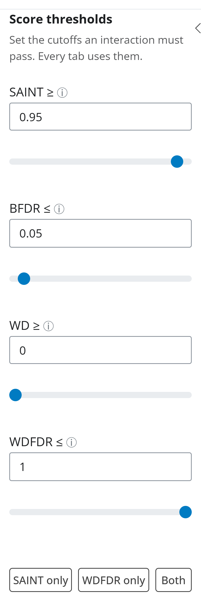
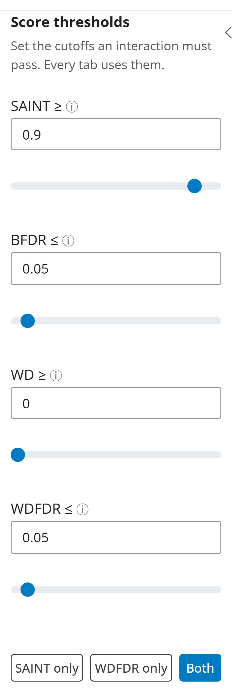

# 1. Getting started

This tutorial explains the handful of scores ProxiMate reports and tours the sidebar,
which every other tab reads. It uses the Human Cell Map datasets that ship with the
ProxiMate image, so there is nothing to upload.

Start the GUI and open http://localhost:3838 in a browser:

```bash
docker run -p 3838:3838 plutzer/proximate
```

## Concepts in plain language

**Baits and controls.** In a proximity-labeling screen (BioID, TurboID, APEX) each
*bait* protein is fused to a labeling enzyme, and every protein labeled near it is
identified by mass spectrometry. Those identified proteins are *preys*. *Controls* are
runs with the enzyme alone (or fused to an unrelated protein); they show what gets
labeled without any particular bait. A prey only counts as a bait's interactor if it is
clearly more abundant with that bait than in the controls. In the experimental design
file, test runs are type `T` and controls are type `C`.

**SAINT score.** SAINT (here, SAINTexpress) compares each prey's abundance with a bait
against its abundance in the controls and returns a probability from 0 to 1 that the
prey is a true interactor. Higher is better; 0.9 is the ProxiMate default cutoff.

**BFDR.** The Bayesian false discovery rate that goes with a SAINT cutoff: the expected
fraction of false interactions among those kept. Lower is stricter; 0.05 is common.

**WD.** The CompPASS WD score rewards preys that are abundant, reproducible across
replicates, and seen with few other baits. It catches "sticky" preys that are labeled by
almost every bait, which SAINT alone can miss when controls are few. Higher is better.

**WDFDR.** A false discovery rate for the WD score, estimated by reshuffling the data
many times (the *WDFDR iterations* set at scoring). Lower is stricter. A dataset scored
with 0 iterations has no WDFDR values.

**The Human Cell Map (HCM).** A BioID screen of 192 baits covering the major compartments
of HEK293 cells (Go et al. 2021, PubMed 34079125). ProxiMate's image ships three scored
versions of it:

| Dataset | What it is |
| --- | --- |
| `HCM_LFQ_Default` | MaxQuant LFQ, 382 experiments (86 controls), scored without imputation. Used in these tutorials. |
| `HCM_LFQ_1comp` | The same data, with missing control values filled by one-component AFT imputation. |
| `HCM_LFQ_2comp` | The same data, with two-component AFT imputation. |

Comparing the three shows how imputation changes the scores; the input data are
identical.

## The sidebar



**Active dataset.** Every tab works on the dataset named here. The badge says whether it
is only *parsed* or already *scored*; tabs that need scores show a message instead of
their controls until the dataset is scored. Pick `HCM_LFQ_Default` from the select.
Clicking a row of the *Datasets* table on the Data & Scoring tab does the same.

**Thresholds.** Four cutoffs decide which interactions *pass*. Each is a number box with
a slider under it: a typed value applies when you press Enter or leave the box, a dragged
slider when you release it. A value outside the cutoff's range shows a warning under the
boxes, and every output that reads the thresholds stays empty until it is fixed. An
interaction passes only when it clears all four:

| Threshold | Default | Meaning |
| --- | --- | --- |
| SAINT ≥ | 0.9 | minimum SAINT score |
| BFDR ≤ | 0.05 | maximum BFDR |
| WD ≥ | 0 | minimum WD score (0 switches the filter off) |
| WDFDR ≤ | 1 | maximum WDFDR (1 switches the filter off) |

Quality Control metrics, Feature Enrichment, the Cytoscape network and thresholded
exports all follow these thresholds, so changing one cutoff changes every tab at once.
Type `0.95` into the SAINT box and press Enter: the slider follows, and no preset button
is highlighted because the values match none of them.



**Presets.** Three buttons set all four thresholds together, and the button matching the
current values is highlighted:

- *SAINT only*: SAINT ≥ 0.9, BFDR ≤ 0.05, WDFDR off. This is the starting state.
- *WDFDR only*: WDFDR ≤ 0.05, SAINT off.
- *Both*: SAINT ≥ 0.9, BFDR ≤ 0.05 and WDFDR ≤ 0.05.

Click **Both**. SAINT returns to 0.9, WDFDR moves to 0.05 and *Both* is highlighted:



Fewer interactions now pass, because each must satisfy SAINT and CompPASS. Click
**SAINT only** to return to the defaults that the remaining tutorials use.

Below the presets, the collapsed *Agent access* panel holds the commands for connecting
an AI agent to ProxiMate's MCP server, and *About and feedback* holds the *Report a bug
or request a new feature* link and the repository link.

## What to look for

- Check the badge before blaming a blank tab: a *parsed* dataset has no scores yet.
- Thresholds are shared. If a tab shows fewer interactions than expected, look at the
  sidebar first; a stray WD or WDFDR cutoff is the usual cause.
- *SAINT only* is a sensible default for a screen with many controls, like HCM. *Both*
  is stricter and trims promiscuous preys that SAINT lets through.
- If WDFDR is below 1 on a dataset scored with 0 WDFDR iterations, a warning appears and
  nothing passes.

Next: [2. Parse and score](2-parse-and-score.md). The full reference for every tab is in
[`GUI/gui_docs.md`](../../GUI/gui_docs.md).
