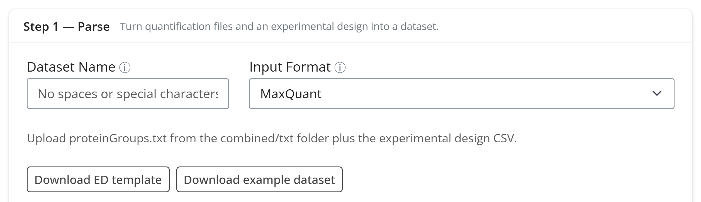
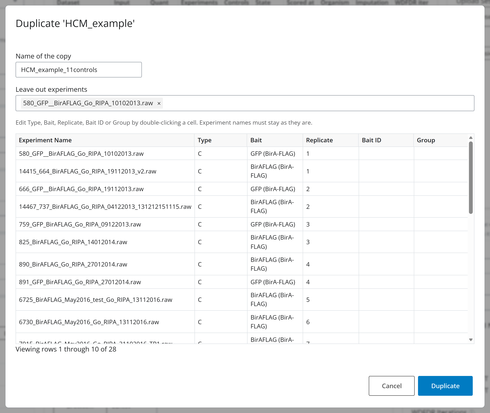
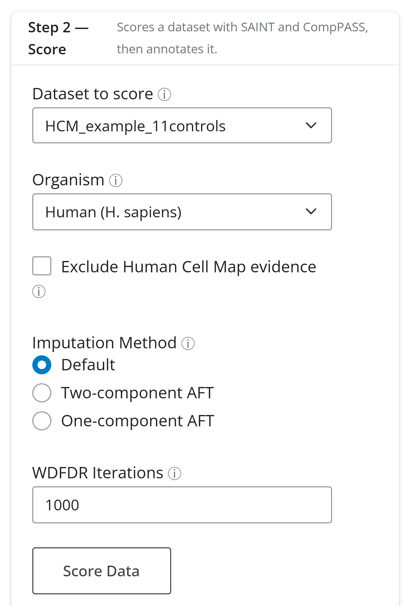

# 2. Parse and score

This tutorial turns a MaxQuant search into a scored ProxiMate dataset: *Step 1 — Parse*
reads the quantification and the experimental design, and *Step 2 — Score* runs SAINT and
CompPASS and annotates the result. It then duplicates the dataset with one control left
out and scores the copy. All of it happens on the **Data & Scoring** tab.

It uses the small example dataset bundled with the GUI, so any installation can follow
it. To re-create the full Human Cell Map datasets instead,
[`examples/HCM_LFQ/`](../../examples/HCM_LFQ) holds the experimental design and SAINT
bait and prey files, and [`examples/README.md`](../../examples/README.md) says where to
get the MaxQuant output.

## Get the example dataset



In the *Step 1 — Parse* card, click **Download example dataset**. The browser saves
`proximate_example_HCM.zip`, which holds two files:

- `proteinGroups.txt`: a MaxQuant protein groups table (1.8 MB) with Intensity, LFQ and
  MS/MS count columns.
- `ED.csv`: its experimental design.

The data are a subset of the Human Cell Map (Go et al. 2021): eight baits from different
compartments, two replicates each, plus twelve control runs (eight of BirA-FLAG alone
and four of GFP-BirA-FLAG), 28 runs in all:

| Bait | Compartment |
| --- | --- |
| COIL | Cajal body |
| LMNA | nuclear lamina |
| NUP50 | nuclear pore |
| SEC61B (named `SEC61B_Nterm` in the design) | endoplasmic reticulum membrane |
| LAMP1 | lysosome |
| PEX14 | peroxisome |
| COX4I1 | mitochondrial inner membrane |
| RAB5A | early endosome |

Unzip the archive somewhere you can find it again.

## The experimental design

The experimental design (ED) is a CSV with one row per MS run:

| Column | Meaning |
| --- | --- |
| Experiment Name | The run's name, exactly as in the quantification file's column headers |
| Type | `T` for a bait (test) run, `C` for a control |
| Bait | The bait's name; replicates of one bait share it |
| Replicate | Replicate number |
| Bait ID | The bait's UniProt accession (optional; used by CompPASS and annotation) |
| Group | Optional control group |

Two rows of the example's `ED.csv`, a control and a bait run:

```
580_GFP__BirAFLAG_Go_RIPA_10102013.raw,C,GFP (BirA-FLAG),1,,
458_LMNA_BirAFLAG_Go_RIPA_06092013_BR1.raw,T,LMNA (BirA-FLAG),1,P02545,
```

The bait names carry the tag as a suffix, `LMNA (BirA-FLAG)`; this is how the bait
appears in every select of the GUI. **Download ED template** writes an empty design with
this header and two example rows.

## Step 1 — Parse


1. **Dataset Name**: `HCM_example`. Use letters, digits and underscores only.
2. **Input Format**: *MaxQuant*. The note under it says which file the format needs and
   which columns are read. The other formats are DIA-NN, Pioneer, FragPipe, MSstats and
   SAINT files.
3. **MaxQuant proteinGroups.txt file**: upload `proteinGroups.txt` from the zip.
4. **Experimental Design File**: upload `ED.csv`. The design (28 rows) appears in the
   table on the right, where you can edit cells before parsing, for example to fix a
   bait name or fill in a missing Bait ID. The edited table is what gets parsed.
5. **Quantification Type**: *LFQ*. MaxQuant offers *Intensity*, *LFQ* and *Spectral
   Counts*, each reading a different column per experiment.
6. Click **Parse Data**.

A progress modal lists the stages, the elapsed time and the end of the dataset's log:


The log shows what the parser removed: reverse hits, proteins only identified by site,
potential contaminants, and proteins found only in controls. Parsing the example takes a
second or two, so the modal flashes by; the same kind of modal appears for scoring,
duplicating, Feature Enrichment and Cytoscape sends. If a job fails, the modal stays open
with the error and the log.

When parsing finishes, a summary strip appears under the button and the new dataset
becomes active:


Check the counts against what you expect: 16 experiments (the bait runs) and 12
controls, matching the `T` and `C` rows of the design, 2477 preys kept, and 69356
experiment-prey quantities written. In *Step 2 — Score*, *Dataset to score* now names
`HCM_example`.

## Step 2 — Score


- **Dataset to score**: the dataset **Score Data** scores. It follows the active dataset
  and a newly parsed one; picking another dataset here changes only what gets scored,
  not the active dataset.
- **Organism**: *Human* here. This picks the annotation databases (BioGRID, UniProt,
  Human Protein Atlas, CORUM).
- **Exclude Human Cell Map evidence**: annotates against a copy of BioGRID with the HCM
  paper's evidence removed. HCM is itself a BioID screen, so leaving its evidence in
  makes proximity hits look more "known" than they are. Tick it when benchmarking
  against BioGRID; this tutorial leaves it off.
- **Imputation Method**: how missing control values are filled before SAINT. *Default*
  fills nothing; the two AFT options model values missing because they fell below
  detection and apply to intensity data only. The preloaded `HCM_LFQ_1comp` and
  `HCM_LFQ_2comp` datasets are the full HCM data scored with the AFT options.
- **WDFDR Iterations**: how many data shuffles estimate the WD false discovery rate.
  1000 is the default; 0 skips WDFDR.

Click **Score Data**. The modal walks through *Running SAINT and CompPASS*, *Adding
protein annotation* and *Updating the datasets table*. For the example the whole run
takes about 20 seconds, and the sidebar badge changes from *parsed* to *scored*.

## Duplicate a dataset

Suppose one control looks like an outlier in the experiment PCA (see
[3. Quality control](3-quality-control.md)) and you want to know how much the scores
depend on it. **Duplicate selected** parses a copy of a dataset from the input stored
with it, under a new name and with an edited design, while the original and its scores
stay as they are.

Click the `HCM_example` row in the *Datasets* table so that it is active, then click
**Duplicate selected**:



- **Name of the copy**: `HCM_example_11controls`.
- **Leave out experiments**: pick `580_GFP__BirAFLAG_Go_RIPA_10102013.raw`, the first GFP
  control. The list offers every experiment of the design.
- The table below is the design. Double-click a cell to edit *Type*, *Bait*,
  *Replicate*, *Bait ID* or *Group*; experiment names stay as they are, because they
  must match the columns of the stored `proteinGroups.txt`.

Click **Duplicate**. The copy is parsed under the usual progress modal, becomes the
active dataset and starts unscored; *Dataset to score* switches to it:



A notification reports the copy's size: 16 experiments and 11 controls. Click **Score
Data** again with the same settings. Once the copy is scored, open **Quality Control**
and switch the active dataset between the two to compare their metrics at the same
thresholds.

## The datasets table


*Datasets* lists every dataset with its input format, quant type, experiment and control
counts, *State* (`parsed`, `scored`, or `enriched` after Feature Enrichment), when and
against which organism it was scored, and, scrolling right, its imputation and WDFDR
settings. Here it holds the three preloaded HCM datasets, the two example datasets, plus
anything else you have loaded. Clicking a row makes that dataset active.

The buttons under the table act on the active (highlighted) dataset or the whole
session:

- **Delete selected** removes the dataset and its directory after a confirmation. A
  network drawn from it stays in Cytoscape.
- **Rename selected** renames the dataset everywhere: directory, table, run manifest and
  the drawn Cytoscape network.
- **Duplicate selected** opens the dialog described above.
- **Clear All Datasets** empties the session.
- **Download Session Zip** saves every dataset and its results as one archive. With the
  three HCM datasets it is over a gigabyte. The *Load a saved session* card next to the
  table restores such an archive with **Load Session**, replacing the current session.

When you are done, select the `HCM_example_11controls` row, click **Delete selected** and
confirm, then do the same for `HCM_example`.

## What to look for

- **Counts match the design.** The experiment and control counts in the summary strip
  should match the number of `T` and `C` rows in your ED. A mismatch usually means an
  Experiment Name does not match a column header in the quantification file.
- **The filters are plausible.** In the parse log, "found only in controls" removes
  background proteins. If it removes most proteins, check that the Type column is not
  swapped.
- **The quant type is the one you meant.** LFQ, Intensity and Spectral Counts give
  different scores from the same file. The table's *Quant* column records which was used.
- **Scoring settings are recorded.** The table's *Imputation* and *WDFDR* columns say how
  each dataset was scored, so datasets scored differently stay distinguishable.
- **Duplicate rather than re-upload.** To drop a run or try another scoring setting,
  duplicate the dataset and change the copy; the original keeps its scores for
  comparison, and the two sit side by side in the table.

Next: [3. Quality control](3-quality-control.md). Reference:
[`GUI/gui_docs.md`](../../GUI/gui_docs.md#data--scoring).
