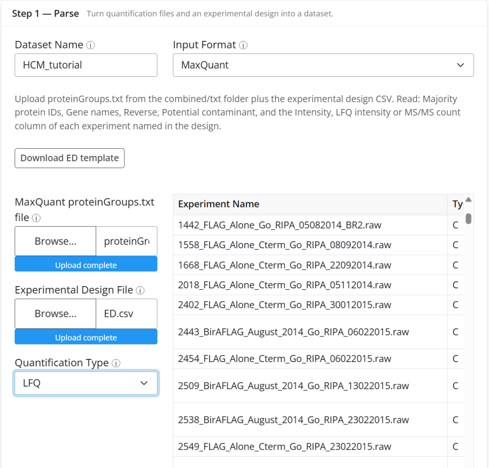
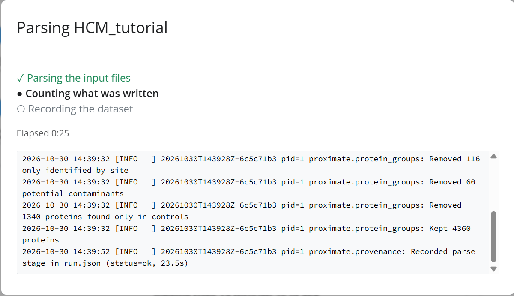
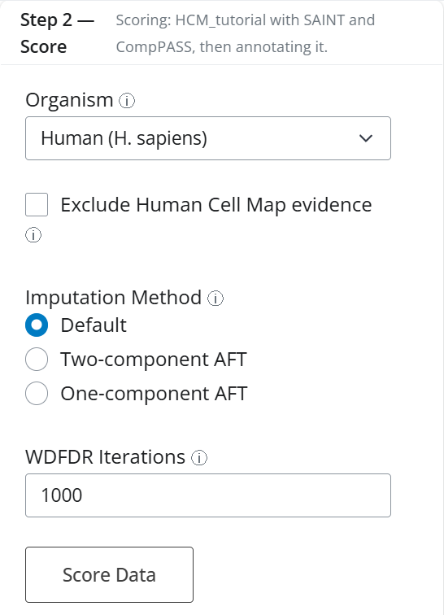
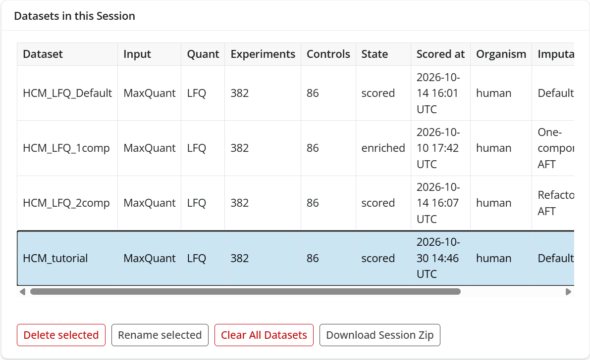

# 2. Parse and score

This tutorial turns a MaxQuant search into a scored ProxiMate dataset: *Step 1 — Parse*
reads the quantification and the experimental design, and *Step 2 — Score* runs SAINT and
CompPASS and annotates the result. All of it happens on the **Data & Scoring** tab.

The example re-creates the Human Cell Map dataset under the name `HCM_tutorial`, from
the `proteinGroups.txt` (117 MB) and `ED.csv` stored with the preloaded `HCM_LFQ_Default`
dataset. To reproduce it from scratch, [`examples/HCM_LFQ/`](../../examples/HCM_LFQ)
holds the experimental design and SAINT bait and prey files, and
[`examples/README.md`](../../examples/README.md) says where to get the MaxQuant output.

## The experimental design

The experimental design (ED) is a CSV with one row per MS run:

| Column | Meaning |
| --- | --- |
| Experiment Name | The run's name, exactly as in the quantification file's column headers |
| Type | `T` for a bait (test) run, `C` for a control |
| Bait | The bait's name; replicates of one bait share it |
| Replicate | Replicate number |
| Bait ID | The bait's UniProt accession (optional; used by CompPASS and annotation) |
| Group | Optional control group |

**Download ED template** in Step 1 writes an empty design with this header and two
example rows.

## Step 1 — Parse

1. **Dataset Name**: `HCM_tutorial`. Use letters, digits and underscores only.
2. **Input Format**: *MaxQuant*. The note under it says which file the format needs and
   which columns are read. The other formats are DIA-NN, Pioneer, FragPipe, MSstats and
   SAINT files.
3. **MaxQuant proteinGroups.txt file**: upload `proteinGroups.txt` from MaxQuant's
   `combined/txt` folder.
4. **Experimental Design File**: upload the ED CSV. The design appears in the table on
   the right, where you can edit cells before parsing, for example to fix a bait name or
   fill in a missing Bait ID. The edited table is what gets parsed.
5. **Quantification Type**: *LFQ*. MaxQuant offers *Intensity*, *LFQ* and *Spectral
   Counts*, each reading a different column per experiment.
6. Click **Parse Data**.

A progress modal lists the stages, the elapsed time and the end of the dataset's log:

The log shows what the parser removed: reverse hits, proteins only identified by site,
potential contaminants, and proteins found only in controls. Parsing this dataset takes
about 25 seconds. The same kind of modal appears for scoring, Feature Enrichment and
Cytoscape sends. If a job fails, the modal stays open with the error and the log.

When parsing finishes, a summary strip appears under the button and the new dataset
becomes active:

Check the counts against what you expect: 382 experiments of which 86 are controls,
4,360 preys kept, and about 2 million experiment-prey quantities written. **Score now**
jumps to Step 2.

## Step 2 — Score

The card header names the dataset it will score (the active one).

- **Organism**: *Human* here. This picks the annotation databases (BioGRID, UniProt,
  Human Protein Atlas, CORUM).
- **Exclude Human Cell Map evidence**: annotates against a copy of BioGRID with the HCM
  paper's evidence removed. HCM is itself a BioID screen, so leaving its evidence in
  makes proximity hits look more "known" than they are. Tick it when benchmarking
  against BioGRID; this tutorial leaves it off.
- **Imputation Method**: how missing control values are filled before SAINT. *Default*
  fills nothing; the two AFT options model values missing because they fell below
  detection and apply to intensity data only. The preloaded `HCM_LFQ_1comp` and
  `HCM_LFQ_2comp` datasets are this data scored with the AFT options.
- **WDFDR Iterations**: how many data shuffles estimate the WD false discovery rate.
  1000 is the default; 0 skips WDFDR.

Click **Score Data**. The modal walks through *Running SAINT and CompPASS*, *Adding
protein annotation* and *Updating the datasets table*. For this dataset the whole run
took under five minutes.

## The datasets table

*Datasets in this Session* lists every dataset with its input format, quant type,
experiment and control counts, *State* (`parsed`, `scored`, or `enriched` after Feature
Enrichment), when and against which organism it was scored, and, scrolling right, its
imputation and WDFDR settings. Clicking a row makes that dataset active.

The buttons under the table act on the active (highlighted) dataset or the whole
session:

- **Delete selected** removes the dataset and its directory after a confirmation. A
  network drawn from it stays in Cytoscape.
- **Rename selected** renames the dataset everywhere: directory, table, run manifest and
  the drawn Cytoscape network.
- **Clear All Datasets** empties the session.
- **Download Session Zip** saves every dataset and its results as one archive. With the
  three HCM datasets it is over a gigabyte. The *Load a saved session* card next to the
  table restores such an archive with **Load Session**, replacing the current session.

When you are done with `HCM_tutorial`, select its row and click **Delete selected**, then
confirm.

## What to look for

- **Counts match the design.** The experiment and control counts in the summary strip
  should match the number of `T` and `C` rows in your ED. A mismatch usually means an
  Experiment Name does not match a column header in the quantification file.
- **The filters are plausible.** In the parse log, "found only in controls" removes
  background proteins. If it removes most proteins, check that the Type column is not
  swapped.
- **The quant type is the one you meant.** LFQ, Intensity and Spectral Counts give
  different scores from the same file. The table's *Quant* column records which was used.
- **Scoring settings are recorded.** The table's *Imputation* and *WDFDR* columns say how
  each dataset was scored, so datasets scored differently stay distinguishable.

Next: [3. Quality control](3-quality-control.md). Reference:
[`GUI/gui_docs.md`](../../GUI/gui_docs.md#data--scoring).
