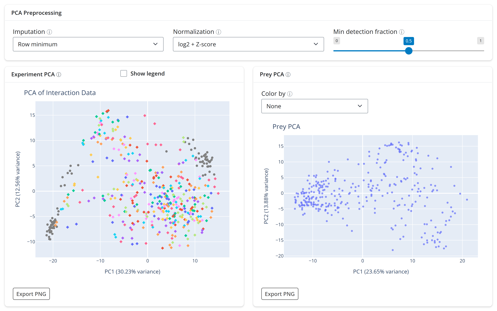
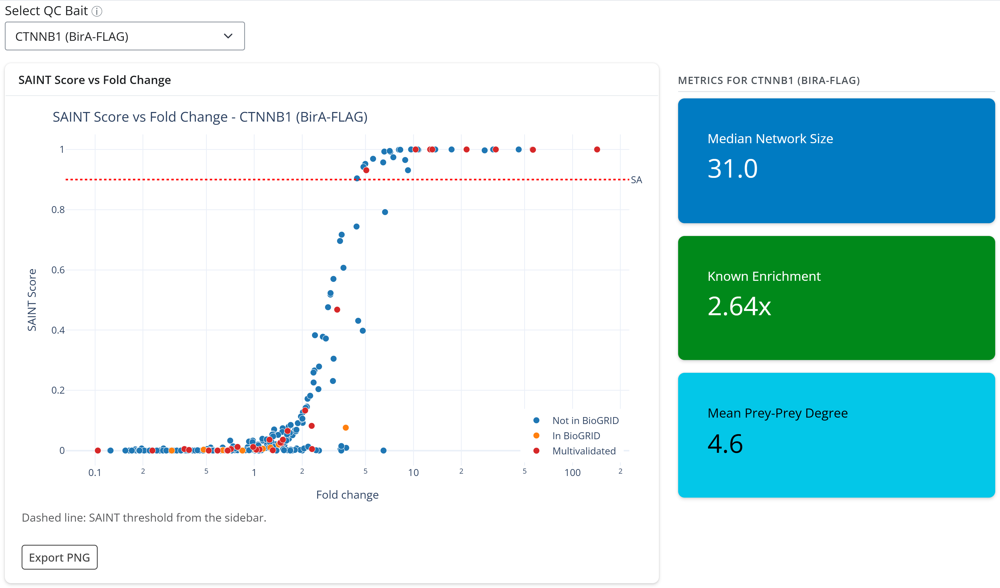
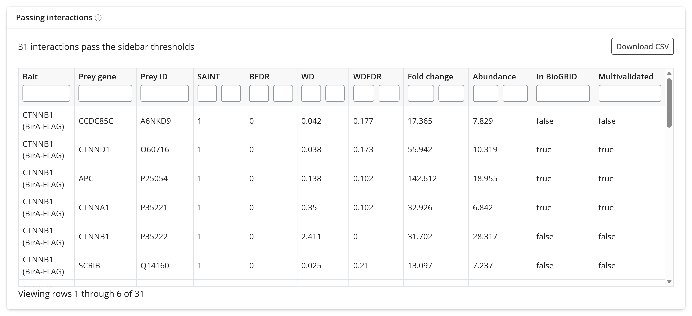

# 3. Quality control

The Quality Control tab answers two questions: did the experiments behave (PCA), and do
the scored interactions look real at the current thresholds (metrics, scatter and
table)? This tutorial checks `HCM_LFQ_Default` as a whole and then the bait CTNNB1
(β-catenin).

Set the active dataset to `HCM_LFQ_Default` and the thresholds to *SAINT only* (see
[1. Getting started](1-getting-started.md)), then open **Quality Control**.

## PCA

The *PCA Preprocessing* card at the top sets how the quantities are prepared for both
PCA plots: *Imputation* (how proteins missing from an experiment are filled; default
*Row minimum*), *Normalization* (default *log2 + Z-score*) and *Min detection fraction*
(keep only proteins seen in at least this fraction of experiments; default 0.5). The
defaults suit MaxQuant intensities. The PCA plots need only a parsed dataset, so they
are the first check to run after parsing.

- **Experiment PCA**: each point is one experiment. Controls are one grey series and each
  bait has its own color. With 192 baits the legend is hidden; tick *Show legend* to see
  it, and hover a point to see its experiment name.
- **Prey PCA**: each point is one prey, placed by its pattern across experiments. *Color
  by* colors the points, for example by the number of experiments a prey was seen in.

*Export PNG* under each plot saves it as an image.

## Metrics and the SAINT scatter

**Select QC Bait** restricts the metrics, scatter and table to one bait. With *All*
selected, the metric tiles summarize every bait; for `HCM_LFQ_Default` at the defaults
they read a median network size of 31 preys, a known enrichment of 3.13x, and a mean
prey-prey degree of 36.6.

Pick **CTNNB1 (BirA-FLAG)**:

- **SAINT Score vs Fold Change** plots every prey seen with CTNNB1: fold change over the
  controls on a log x-axis, SAINT score on the y-axis. The dashed red line is the
  sidebar's SAINT cutoff. Red points are BioGRID-multivalidated interactions with
  CTNNB1, orange points are in BioGRID with less evidence, and blue points are not in
  BioGRID.
- **Median Network Size**: the number of preys passing the sidebar thresholds (31 for
  CTNNB1; with *All* selected, the median across baits).
- **Known Enrichment**: how much more often the passing interactions are already in
  BioGRID than all scored interactions are. CTNNB1's 2.64x means its passing preys are
  2.6 times richer in known interactions than chance.
- **Mean Prey-Prey Degree**: on average, how many known BioGRID partners each passing
  prey has among the other passing preys (4.6 for CTNNB1). A high value means the preys
  form complexes rather than a random set.

Change the SAINT cutoff in the sidebar and watch the tiles and the dashed line follow.
*Export PNG* under the plot saves it as
`HCM_LFQ_Default_CTNNB1_BirA-FLAG_SAINT_scatter_SAINT0.9.png` (it needs one bait
selected; with *All* it shows an error); every download on this tab is named after the
dataset, the bait and the settings that shaped it.

## Passing interactions

The *Passing interactions* table lists every interaction that passes the sidebar
thresholds for the selected bait, here 31 rows for CTNNB1 (7,023 rows for *All*). Each
column has a filter box (two boxes, minimum and maximum, for numeric columns), and
clicking a header sorts by it. *Abundance* is the prey's average quantity across the
bait's replicates (the `AvgIntensity` column of the scores). *Download CSV* saves the
same rows; for this example it writes
`HCM_LFQ_Default_CTNNB1_BirA-FLAG_passing_SAINT0.9_BFDR0.05_WD0_WDFDR1.csv`.

For CTNNB1 the list opens with the core of the cadherin-catenin complex: CTNND1
(p120-catenin), APC, CTNNA1 (α-catenin), JUP (plakoglobin) and CTNNB1 itself, all
flagged as known in BioGRID.

## What to look for

- **Replicates cluster.** In the experiment PCA, replicates of one bait should sit
  together, and controls should form their own group. A replicate far from its partner
  may be a failed run; check it before trusting that bait's scores.
- **The scatter has an S shape.** Most preys sit at low fold change and SAINT near 0, and
  a separate group rises to SAINT near 1 at high fold change. A bait whose preys all
  hug the bottom had no clear enrichment over the controls.
- **Known interactions pass.** Red and orange points above the dashed line, and a known
  enrichment well above 1x, say the thresholds keep real biology. A known enrichment
  near 1x suggests the thresholds are too loose for that bait.
- **Self-detection is expected.** The bait itself (CTNNB1 here) usually passes, because
  the fusion protein is labeled most strongly.

Next: [4. Exploring interactors](4-exploring-interactors.md). Reference:
[`GUI/gui_docs.md`](../../GUI/gui_docs.md#quality-control).
