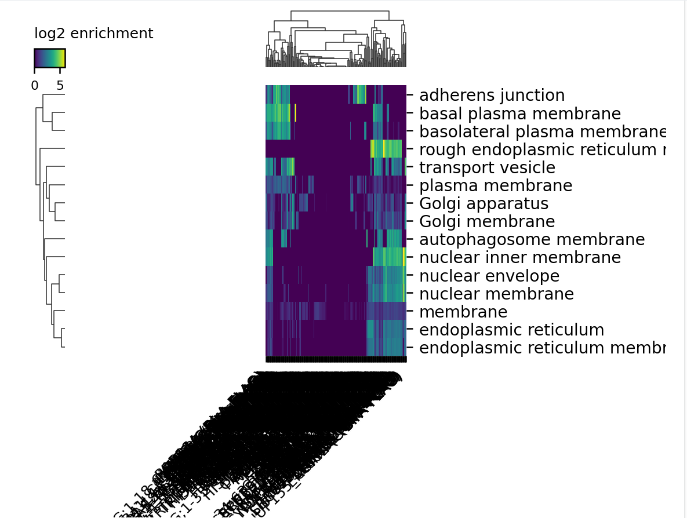
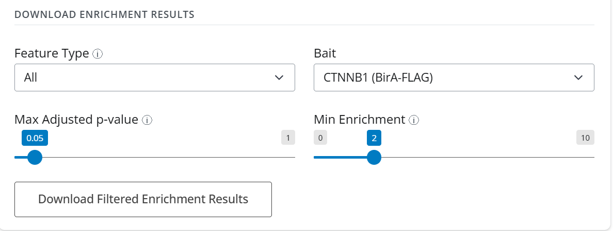
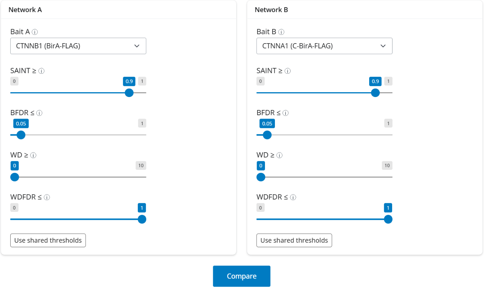
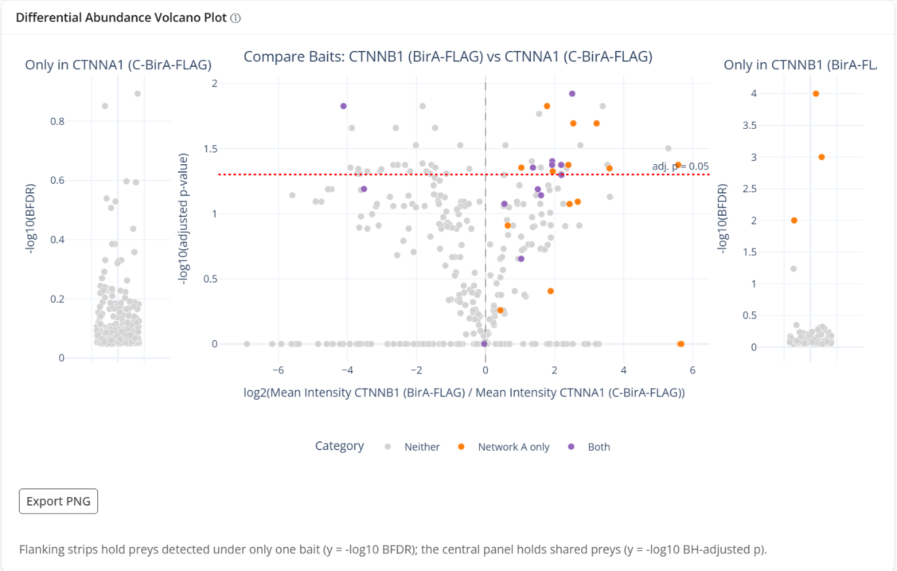
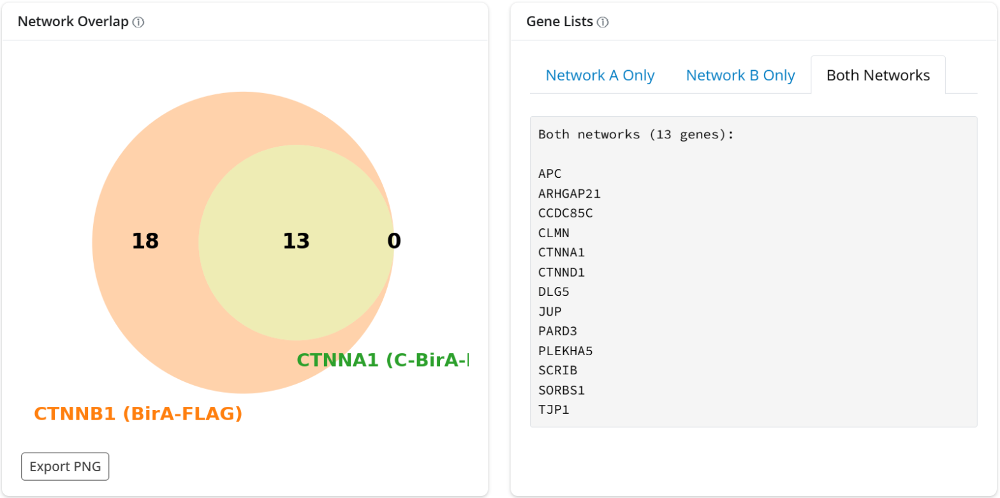

# 4. Exploring interactors

Once a dataset is scored, two tabs help interpret the interactors: **Feature
Enrichment** asks what the passing preys of each bait have in common, and **Compare
Baits** sets two baits side by side. This tutorial uses `HCM_LFQ_Default` at the
*SAINT only* thresholds, with the cell-junction baits CTNNB1 (β-catenin) and CTNNA1
(α-catenin).

## Feature Enrichment

For each bait, the preys that pass the sidebar thresholds (the *foreground*) are tested
for over-represented features against every prey detected in the run. Features are Gene
Ontology terms (cellular component *GO_CC*, biological process *GO_BP*, molecular
function *GO_MF*) and UniProt sequence features (motifs, regions, repeats,
compositions, domains).

1. Open **Feature Enrichment** and click **Run Feature Enrichment** in the *Foreground*
   card. The job runs under a progress modal for under a minute on this dataset and
   writes `Feature_enrichment.csv` into the dataset's directory; the dataset's State in
   the session table becomes `enriched`.
2. In the *Top features* card, *Select Feature Type* picks the feature family for the
   heatmap (`GO_CC` here) and *Number of Features to Display* how many rows it shows
   (15 here; the default is 30).

Rows are features, columns are baits, and color is log2 enrichment; both are clustered,
so baits with similar localization sit together. With all 192 HCM baits the column
labels overlap, so read the heatmap for its blocks (a group of baits sharing
*nuclear envelope*, another sharing *adherens junction*) and use the download below for
single baits. *Export Heatmap PNG* saves the figure.

### Download the results for one bait

Under *Download enrichment results*, set *Bait* to **CTNNB1 (BirA-FLAG)**, leave
*Feature Type* at *All*, and keep the defaults *Max Adjusted p-value* 0.05 and *Min
Enrichment* 2. **Download Filtered Enrichment Results** saves a CSV
(`enrichment_HCM_LFQ_Default_<date>_<time>.csv`) with one row per feature: the feature
name, its GO id, how many foreground preys carry it (`k`) out of the foreground (`n`),
how many detected preys carry it (`K`) out of all detected preys (`M`), the p-value,
the enrichment and the adjusted p-value.

For CTNNB1 the top rows are *cell junction* (16 of its 31 passing preys, about 31-fold
enriched), *adherens junction*, *anchoring junction* and *catenin complex*: the passing
preys are where β-catenin is expected to be.

## Compare Baits

Open **Compare Baits**. The *Network A* and *Network B* cards each pick a bait and
carry their own copy of the four thresholds, which start from the sidebar values;
*Use shared thresholds* copies the sidebar's current values into that card.

Set **Bait A** to *CTNNB1 (BirA-FLAG)* and **Bait B** to *CTNNA1 (C-BirA-FLAG)*, then
click **Compare**.

### Volcano plot

- The **central panel** holds preys detected with both baits: log2 of the ratio of mean
  intensities (positive means more with CTNNB1) against the BH-adjusted t-test p-value.
  The dotted red line marks adjusted p = 0.05.
- The **flanking strips** hold preys detected with only one bait (left: only CTNNA1;
  right: only CTNNB1), plotted by their SAINT BFDR because there is no ratio to take.
- Color says where a prey passes the thresholds: *Network A only* (orange), *Network B
  only*, *Both* (purple) or *Neither* (grey). Here no prey passes for CTNNA1 alone, so
  that category does not appear in the legend.

### Overlap and gene lists

The Venn diagram counts preys passing in A only, in both, and in B only. CTNNB1 has 31
passing preys and CTNNA1 has 13, and every CTNNA1 prey is shared with CTNNB1. The *Gene
Lists* tabs hold the genes behind each region as plain text to copy; *Both Networks*
lists the 13 shared ones, among them CTNND1, JUP, APC, PARD3 and TJP1.

## What to look for

- **Enrichment should match the bait's biology.** CTNNB1's top terms are cell-junction
  terms. A bait whose top terms disagree with its known localization deserves a second
  look at its QC.
- **Counts behind fold changes.** In the enrichment CSV, a large enrichment from `k` = 2
  or 3 preys is weaker evidence than a moderate one from 15.
- **Shared preys mean a shared neighborhood.** α- and β-catenin bind each other at
  adherens junctions, so a large shared set is expected. The CTNNB1-only preys
  (for example ERBIN, MAGI1, PLEKHA7, AFDN) point to what β-catenin reaches that
  α-catenin's tag does not.
- **Compare like with like.** The thresholds in the two cards are independent; check
  that they match before reading differences in network size.

Next: [5. Networks and export](5-networks-and-export.md). Reference:
[`GUI/gui_docs.md`](../../GUI/gui_docs.md#feature-enrichment).
