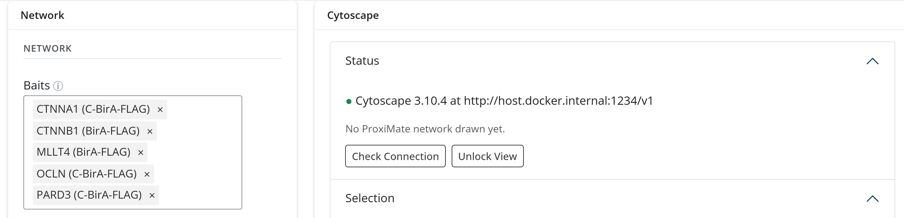
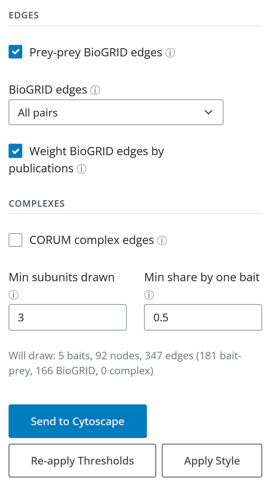
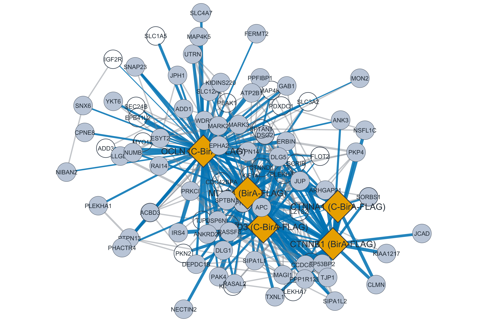
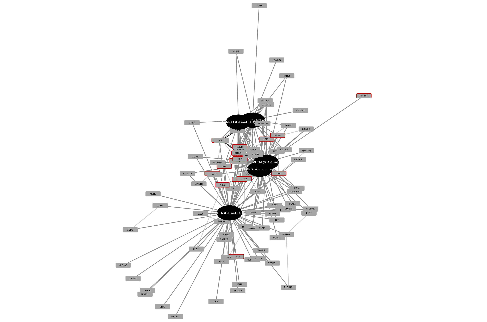
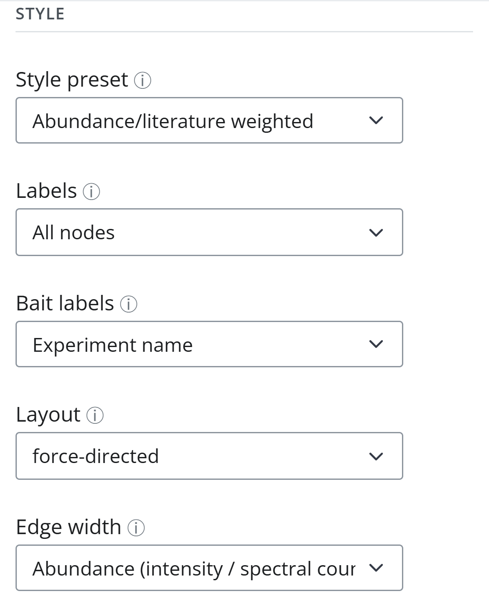
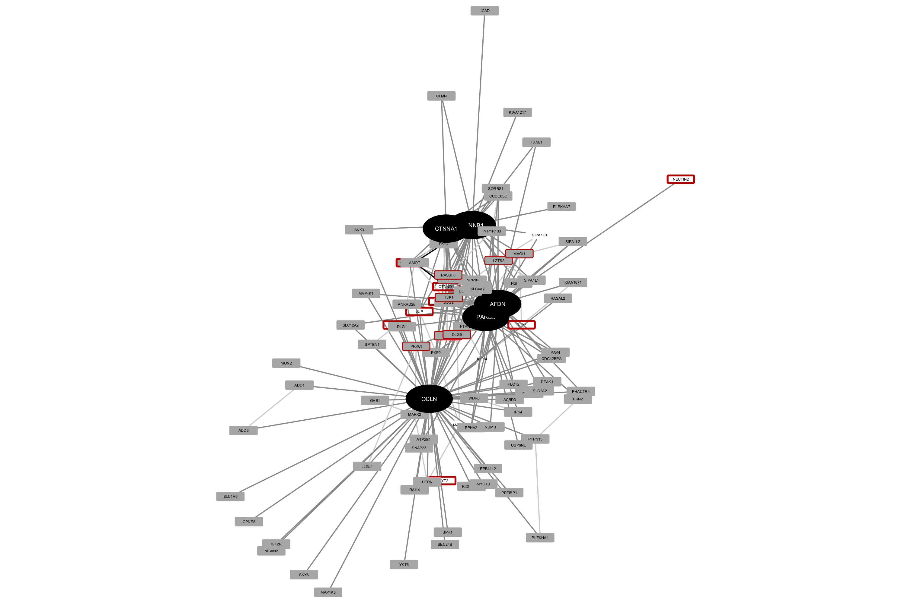
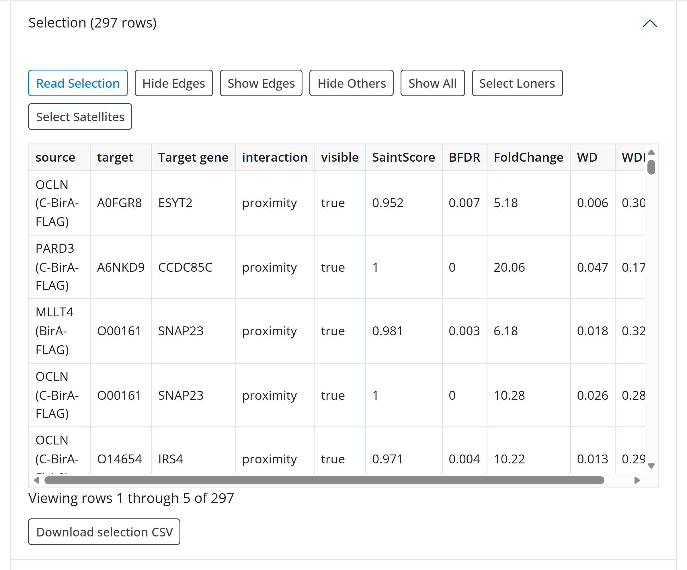
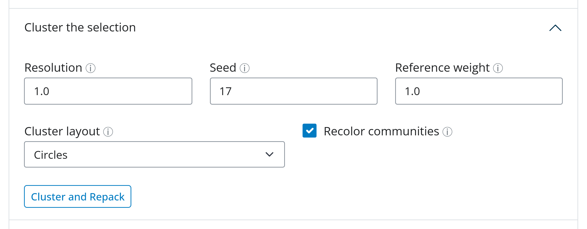
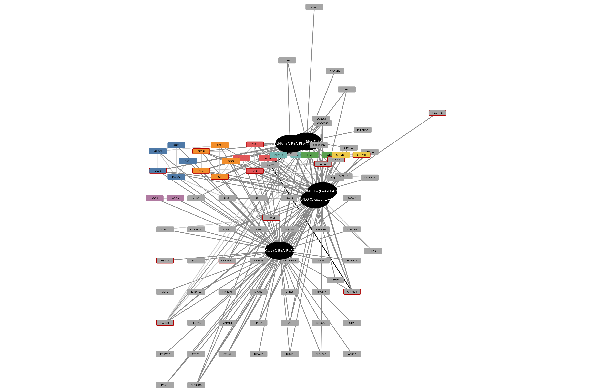
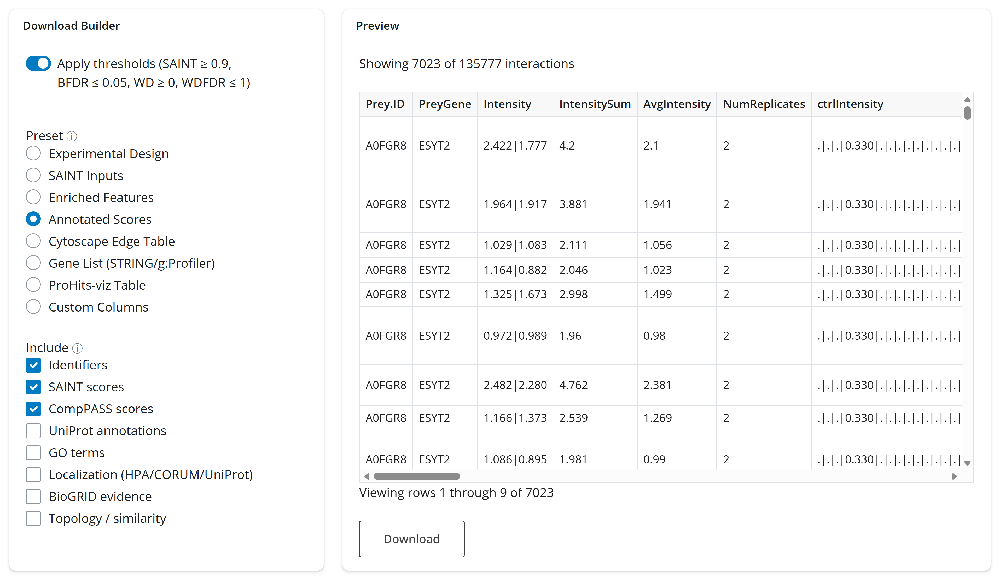

# 5. Networks and export

This tutorial draws the cell-junction baits of `HCM_LFQ_Default` in Cytoscape, restyles
the network, selects and clusters part of it, and then exports results from the Export
tab. It uses the *SAINT only* thresholds (see [1. Getting started](1-getting-started.md)).

## Before you start

Install [Cytoscape](https://cytoscape.org/) (3.10 or later) on the computer running
Docker and start it before sending a network. ProxiMate reaches it at
`host.docker.internal:1234`, Cytoscape's built-in REST port. The README's
[Cytoscape section](../../README.md#cytoscape) covers setups where Cytoscape runs
elsewhere.

## Send the network

Open the **Cytoscape** tab. The *Status* panel on the right says whether Cytoscape
answers; click **Check Connection** if it does not show a green dot.

In the *Network* card, add the five baits to **Baits**: `CTNNA1 (C-BirA-FLAG)`,
`CTNNB1 (BirA-FLAG)`, `MLLT4 (BirA-FLAG)` (afadin), `OCLN (C-BirA-FLAG)` and
`PARD3 (C-BirA-FLAG)`. Type a gene name and pick the bait from the list; names carry the
tag suffix. Leaving the field empty draws every bait.

Below the baits, the card repeats the sidebar thresholds (read-only) and holds the style
options. Scroll down to the edge options:

- **Prey-prey BioGRID edges** adds edges between preys known to interact; *BioGRID
  edges* chooses all known pairs or only multivalidated ones, and *Weight BioGRID edges
  by publications* thickens well-studied pairs.
- **CORUM complex edges** links preys that belong to one CORUM complex, when at least
  *Min subunits drawn* of its members are drawn and at least *Min share by one bait* of
  them come from one bait.
- The **Will draw** line counts what a send will produce and updates as you change the
  baits, thresholds or edge options. Here: 5 baits, 92 nodes and 347 edges (181
  bait-prey, 166 BioGRID, 0 complex).

Click **Send to Cytoscape**. A progress modal runs while the network is built and drawn,
and the *Activity* table at the bottom of the tab logs the draw.

The default *Abundance/literature weighted* style draws baits as orange diamonds and
preys as blue-grey circles. Blue bait-prey edges widen with abundance, and grey
prey-prey BioGRID edges widen with publication count.

## Restyle

Set **Style preset** to *Highlight knowns*. Picking a preset also sets the options it is
designed for (here a Kamada-Kawai layout, uniform edge width, multivalidated BioGRID
edges only, and CORUM complex edges), which you can still change.

- **Apply Style** restyles the drawn network in place and keeps its layout.
- **Send to Cytoscape** redraws it, which also applies the layout and the CORUM edges.
  Each send replaces the previous ProxiMate network.

Here, send again to get the new layout:

Baits are black ellipses and preys grey boxes. A red border marks a prey whose
interaction with a drawn bait is BioGRID-multivalidated. OCLN (bottom) has its own
large neighborhood, while CTNNA1, CTNNB1, MLLT4 and PARD3 share many preys and sit
together above it.

## Labels

In the *Style* section, **Labels** sets which nodes carry a label and **Bait labels**
what a bait's label says: its *Experiment name* (the default, `CTNNB1 (BirA-FLAG)`) or
its *Gene symbol* (`CTNNB1`). The symbol comes from the scores, so MLLT4 is labeled
AFDN, its current gene symbol; a bait whose accession has no gene in the scores keeps
its experiment name. Set *Gene symbol* and click **Apply Style**: the labels of the
drawn network change in place and the layout stays.

Gene symbols read better on a poster; experiment names tell two constructs of one gene
apart. Set *Bait labels* back to *Experiment name* and apply the style again; the rest
of this tutorial uses the experiment names.

**Re-apply Thresholds** hides edges that fail tighter sidebar thresholds without
redrawing, so a hand-made layout survives. Loosening the thresholds needs a new send.

## Select

Expand **Select by relation** in the *Cytoscape* card. Enter the seed `OCLN (C-BirA-FLAG)`
(a bait's experiment name, its gene symbol or its UniProt accession all work, whichever
label the network shows), keep *Relation* at *Interactors of a bait*, and click
**Replace Selection**. Cytoscape selects OCLN's 66 interactors. The optional *Min
SAINT*, *Max BFDR*, *Min abundance* and *Min publications* boxes narrow the relation.

In the *Selection* panel, click **Read Selection**:

The table lists every edge touching the selected nodes with its scores (297 rows here;
the BioGRID edges the *Highlight knowns* preset hides are not among them),
and **Download selection CSV** saves it as `HCM_LFQ_Default_selection.csv`. The other
buttons act on the selection in Cytoscape: hide or show the edges around it, hide
everything else, and, with exactly one bait selected, *Select Loners* (that bait's
preys with no other visible neighbor) or *Select Satellites* (preys sitting nearer that
bait than any other).

## Cluster

Expand **Cluster the selection** and click **Cluster and Repack** with the defaults. The
Leiden algorithm splits the selected preys into communities using the drawn edges,
colors every community of two or more, and lays each out as a circle (*Cluster layout*).
Selected baits stay in place. *Resolution* sets community size (higher gives more,
smaller communities) and *Seed* makes the result repeatable.

Here the 65 preys fall into 50 communities. Seven have two or more members, for example
APC with JUP, DSG2 and PKP2, SPTBN1 with SPTAN1, and ADD1 with ADD3; the other 43 are
single preys with no drawn edge to another selected prey, packed in a grid below. The
preys stay selected after clustering, and Cytoscape's yellow selection highlight hides
the community colors until you click an empty spot of the canvas.

*Saved layouts* stores and restores node positions by name, and *Export* writes a PNG of
the network into the dataset's `cytoscape/` folder.

## Export

The **Export** tab saves the active dataset's results.

1. Turn on **Apply thresholds** to keep only interactions passing the sidebar
   thresholds. Its label repeats the values. Left off, score-based presets export every
   row.
2. Pick a **Preset**: Experimental Design, SAINT Inputs, Enriched Features (after Feature
   Enrichment), Annotated Scores, Cytoscape Edge Table, Gene List (pooled or per bait,
   for STRING or g:Profiler), ProHits-viz Table, or Custom Columns.
3. For presets with column groups, **Include** toggles them. *Annotated Scores* starts
   with identifiers, SAINT scores and CompPASS scores; tick UniProt, GO, localization,
   BioGRID or topology columns to add them.
4. The **Preview** shows exactly what will be saved: here "Showing 7023 of 135777
   interactions". **Download** saves it, for example
   `HCM_LFQ_Default_annotated_<date>_<time>.csv`.

**Batch Export** → *Download All Results (ZIP)* bundles `merged.csv`,
`annotated_scores.csv`, `Feature_enrichment.csv` (if enrichment was run) and the SAINT
input files into one archive. For the HCM datasets that is several hundred megabytes, so
prefer the Download Builder when one table is enough. The *Download Session Zip* button
on the Data & Scoring tab is larger still: it holds every dataset in the session and
restores them all with *Load Session*.

## What to look for

- **Check the Will draw line before sending.** Thousands of edges make an unreadable
  hairball. Switch BioGRID edges to *Multivalidated only*, tighten the thresholds or draw
  fewer baits.
- **Shared preys pull baits together.** Baits that share many preys sit close in the
  layout, like CTNNA1, CTNNB1, MLLT4 and PARD3 here. A bait off on its own, like OCLN,
  labels a different neighborhood.
- **Red borders and colored communities are independent evidence.** A cluster whose
  members are already known to bind each other (APC, JUP, DSG2, PKP2) is likely a real
  complex near the bait. Singletons are not wrong; they just have no known partner among
  the selection.
- **Export what you filtered.** With *Apply thresholds* on, exports match the
  interactions shown in Quality Control and Cytoscape; with it off they include every
  scored pair.

Back to the [tutorial index](README.md). Reference:
[`GUI/gui_docs.md`](../../GUI/gui_docs.md#cytoscape).
